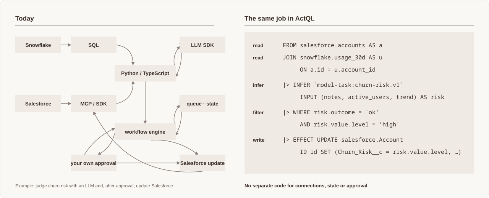

# Concepts

ActQL is the SQL-based data & workflow engine for AI agents. A Program reads
across SaaS APIs, warehouses and databases, joins the data, asks a model — an
LLM — for decisions, and writes back. This page gives you the whole picture in
one read: what ActQL is for, the parts it is made of, and how one execution
goes from text to a change in an external system. The
[specification](../spec/README.md) defines each term precisely, and the
[glossary](glossary.md) lists them in one place.

## Why ActQL

Agents increasingly do work that spans systems: read accounts from Salesforce,
read usage from a warehouse, judge each account, write a result back. Today an
agent does that by calling tools — MCP servers, or functions someone prepared —
one at a time. Each call can be checked, but there is no way to check the
job as a whole — what it reads, what it computes and which external systems
it may change — under one set of types and one meaning, before it runs.
Writes are approved one call at a time, and what the approver sees is the
agent's description of the write. Durable execution, approval and
reconciliation are each assembled from a separate piece:



ActQL expresses that work as one SQL Program, and runs it under an engine
that can check it before it runs, decide what needs a person, and record
everything it does. You get:

- **One Program across systems.** SaaS APIs, warehouses and databases are
  read and written from one pipeline. No workflow per integration, and no
  per-API code in the Program.
- **One type system.** SaaS rows, warehouse rows and model answers are
  checked under one type system, so you join and filter them with plain SQL,
  and mismatches are caught before anything runs.
- **Writes approved from what will actually be written — and you decide
  how.** Route by record count or target: low-risk writes go straight through,
  some are approved by rule, and only high-risk ones wait for a person, who
  sees the exact records and values. An agent can never grant itself
  permission.
- **Safe to stop and resume.** A crash or a restart never repeats finished
  work, and a write with an unknown outcome is never blindly sent again.
- **Any scale, any place.** The same Program runs inside your application,
  behind the CLI, on a server or in ActQL Cloud. Aggregation runs where the
  data is, such as in Snowflake, and cross-system joins run in ActQL's own
  engine or in DuckDB depending on the data size, so the Program stays the
  same as the data grows.

## Programs

A **Program** is one piece of work written in ActQL. It reads data, computes,
can ask a model, and can write changes back. Programs are SQL with Pipe syntax,
extended only for what SQL cannot express, such as calling models and writing
back.

```sql
SELECT a.id AS id, a.description AS notes,
       u.active_users, u.trend
FROM salesforce.accounts AS a
JOIN snowflake.usage_30d AS u ON a.id = u.account_id
|> INFER `model-task:churn-risk.v1`
     INPUT (notes, active_users, trend) AS risk
|> WHERE risk.outcome = 'ok' AND risk.value.level = 'high'
|> EFFECT UPDATE salesforce.Account
     ID id SET (
       Churn_Risk__c = risk.value.level,
       Risk_Reason__c = risk.value.reason
     );
```

Read it from top to bottom:

1. Join Salesforce accounts with usage data from Snowflake.
2. Ask a model to judge each account's churn risk.
3. Keep the accounts it judged high-risk.
4. Write the risk back to Salesforce.

A Program can declare parameters, whose values you supply when you run it. It
can return rows to the caller (a **Result**), write to external systems (an
**Effect**), or both. Everything it works with — rows from Salesforce, rows
from a warehouse, a model's answer — has a type, so mistakes such as a type
mismatch are found before anything runs.

You can run the same Program as often as you like. Each execution is a
**Run**, and the Run records what that execution read and did.

## How the pieces fit

Three parts work together when a Program runs:

```text
  Your application · CLI · agent
               │  Program
               ▼
  ┌─────────────────────────────────────────┐
  │ Host                                    │
  │  policy · credentials · Run records     │
  │  ┌───────────────────────────────────┐  │
  │  │ Core                              │  │
  │  │  checks, plans and computes       │  │
  │  └───────────────────────────────────┘  │
  └─────────────────────────────────────────┘
               │
               ▼
  Connectors → Salesforce · Snowflake · Slack · …
```

- **Core** decides what a Program means: it checks it, plans it and computes
  the results. ActQL defines data processing as typed algebraic operations,
  which is what lets the engine rewrite a plan without changing its meaning.
- The **Host** runs ActQL in your environment. It holds your policy and
  credentials, and keeps the record of every Run. A Host can live inside your
  application, behind the CLI, on a remote server, or in ActQL Cloud.
- **Connectors** talk to external systems.

People and agents take three roles around them:

| Role | Who | Does |
| --- | --- | --- |
| Author | A person or an agent | Writes Programs and runs them |
| Operator | Whoever runs the Host | Sets up connections, credentials and policy |
| Decider | A person, a rule or an approval application | Answers when policy asks |

In short: **AI writes, the engine checks, the Host decides.** A Program never
defines credentials or permissions; those belong to the Host.
[Architecture](architecture.md) explains each part in detail.

## Connectors

A **Connector** connects ActQL to one external system, such as Salesforce or
Snowflake. In a Program you only see names like `salesforce.accounts`.
Authentication, paging, rate limits and the differences between APIs are
handled inside the Connector, so the Program does not have to deal with them.

Each Connector tells ActQL three things:

- **What can be read** — for example Salesforce accounts, with their columns
  and types.
- **What operations it can perform** — for example updating a Salesforce
  record, posting to Slack, or sending an email with Gmail.
- **What the system can compute itself** (its capabilities) — filtering,
  aggregating, searching — and roughly what it costs.

For example, Snowflake can filter and aggregate on its own. So instead of
fetching all the data, ActQL hands that work to Snowflake (pushdown) — but only
when the result stays exactly the same. This is how the same Program handles a
few rows and a few terabytes: the Program stays the same; the plan changes.

What a Connector can do is separate from whether a Program may actually do it.
That is decided by policy, every time; see
[Effects and policy](#effects-and-policy).

## Models and model tasks

`INFER` takes each row of a table as input and has a model return typed data
for it. This is how unstructured input, such as free-text notes, becomes
structured values you can query.

The instructions for the model and the types of its input and output are
defined once, as a versioned **model task**. You never write a prompt or an
output schema inside the SQL. The model task that judges churn risk looks
like this:

```yaml
# model-tasks/churn-risk.v1.yaml
task: model-task:churn-risk.v1
input:
  notes: string
  active_users: int64
  trend: string
instructions: |
  From the account notes, the number of active users and the usage trend,
  rate the churn risk as low, medium or high and explain why in one line.
  Do not assume facts that are not in the input.
output:
  level: {type: string, enum: [low, medium, high]}
  reason: string
```

A Program refers to it by name:

```sql
|> INFER `model-task:churn-risk.v1`
     INPUT (notes, active_users, trend) AS risk
|> WHERE risk.outcome = 'ok' AND risk.value.level = 'high'
```

`INPUT` names the columns each row sends to the model; `AS risk` names the
result. Because `level` and `reason` are typed by the model task's output,
ActQL can type-check the rest of the SQL before anything runs. The model task
says what to ask the model and what type comes back; the SQL says which data
to apply it to and what to do with the answer.

Each row gets an `outcome` — success or failure — and, on success, a `value`
of exactly that type, as columns like any other. On failure, the value is
NULL and the reason is recorded. That is why the example keeps only rows with
`risk.outcome = 'ok'`.

| Input `notes` | Output `level` | Output `reason` |
| --- | --- | --- |
| "Usage is dropping and they mentioned evaluating a competitor." | `high` | Falling usage and a competitor evaluation |

The model's answer is recorded in the Run as an observation from outside, not
as a computed result. If the Run is resumed or recovered, ActQL reuses the
recorded answer instead of asking the model again. What ActQL guarantees is
the type of the answer and how it is handled; it does not guarantee that the
model's judgement is correct, so where a wrong answer would be costly, policy
and Checkpoints put a person in the loop.

Only the columns named in `INPUT` are sent to the model, and that call, like
any other access to an external system, goes through the Host's policy.

## Effects and policy

An **Effect** is an action on an external system: updating a record, adding a
row, posting a message, sending an email. You can write a change as an
`EFFECT` stage or with familiar SQL such as `INSERT` and `UPDATE`. Either way,
it is an Effect, and every Effect goes through policy.

Policy is not written in the Program. The operator sets it up on the Host, per
user, connection, resource and operation. Before reading from a system or
applying an Effect, ActQL asks the policy, and the answer is one of three:

- **allow** — go ahead;
- **deny** — stop without sending anything;
- **delegate** — hand the decision to the decider the operator set up.

The decider can be a person, a rule that decides automatically, an approval
application, or a combination. For example, updates of up to 100 records could
be approved automatically, while larger ones wait for a person. As a Program
proves itself, more of its writes can move from a person to a rule, on the
same mechanism.

If the decider answers right away, the Run continues or stops right away. If
the decision has to wait, the Run stops at a **Checkpoint**. A Checkpoint saves
a preview of what would change — which records and fields, with their new
values, and the current values too where the Connector can provide them —
before anything is written. The preview is derived from recorded results, so
the approved content is fixed, and it is checked again right before it is
applied. This closes the time-of-check/time-of-use (TOCTOU) gap between
approval and application: what was approved is exactly what is applied.
Approving continues the same Run, without redoing finished work, and covers
only the changes in that preview.

## Run lifecycle

One execution goes through these steps:

1. **Check** — names, types and the permissions the Program needs are
   validated against the Host's definitions. No data is read. Whether the
   Program is actually allowed is decided at run time.
2. **Plan** — parameters are filled in, and the limits and the places where
   the Program touches external systems are fixed. Still no data is read.
3. **Run** — data is read, the model is asked, and changes are previewed.
4. **Wait at a Checkpoint** — only if a decision has to wait. Until it
   arrives, nothing that touches an external system or a model happens.
5. **Resume** — the same Run continues from where it stopped and applies the
   approved changes.
6. **Finish** — the Run ends as succeeded, failed or cancelled. Succeeded
   means every write was confirmed or accepted by the external system; an
   accepted asynchronous write may still be finishing there.

Because the first two steps read nothing, an agent can write a Program, check
it and read its plan before it touches any real system.

On the console the same steps are `check`, `explain`, `run`, `approve` and
`status`; [Execution model and guarantees](execution-model.md) shows their
output next to the guarantee each one demonstrates.

A Run can stop at any step — for an approval, a crash or a restart — and it
resumes from where it was: data that was read, model answers and writes that
were sent are all recorded and reused, and an Effect that was sent is never
sent again.

In real operation, a write can end without anyone knowing whether it succeeded
or failed — for example, when the connection drops right after the request was
sent. ActQL records that outcome as *unknown* for that operation and checks
with the system what actually happened. It never simply sends the write
again, and if the outcome cannot be resolved, the Run stays in
`needs_reconciliation` with that outcome visible rather than guessing.

Every Program has limits — on rows, bytes, model calls and more. Going over a
limit stops the work with an error; ActQL never returns a partial result as if
it were complete.

## Beyond tables

Most of the time you work with rows. ActQL also has three other kinds of
values, for work that rows do not express well:

| Kind | Holds | Used for |
| --- | --- | --- |
| Relation | Rows with typed columns | Filtering, joining, aggregating |
| Graph | Nodes and edges | Following relationships |
| Vectors | Fixed-size vectors | Similarity and nearest-neighbour search |
| Events | Timestamped events | Sessions, windows and time patterns |

Each of these can be turned back into typed rows explicitly, so vector search,
graph traversal and event matching compose with ordinary joins, filters, `INFER` and `EFFECT` in
the same Program. Turning one kind into another, such as a graph match into
rows, is always written out explicitly. The specification calls these kinds
**Carriers**.

## What ActQL is not

- **Not a database of record.** Your business data stays in the SaaS
  systems and databases that own it. ActQL keeps what execution, approval and
  recovery need: Run records, captured results and previews.
- **Not an agent framework.** You build the agent with whatever you like;
  the agent writes ActQL Programs and hands them to the engine to check,
  approve and run.
- **Not an agent control loop or a scheduler.** A Program declares a finite
  unit of work. A Run can stay open for a long time — waiting for an
  approval, for an asynchronous system or for recovery — but deciding what to
  do next, and starting work on a schedule, belong to the agent or scheduler
  that calls ActQL.
- **Not a transaction across systems.** If the Salesforce update went
  through and the Slack post then failed, the update is not undone. What
  ActQL does instead is record exactly which writes were applied, so you can
  see where the Run stopped and decide what to do.

## Next

Read the rest of this section in this order:

- [Execution model and guarantees](execution-model.md): what ActQL guarantees, and what it does not.
- [Language design](language-design.md): why ActQL looks the way it does.
- [Architecture](architecture.md): how Core, Hosts and Connectors fit together, with the example above walked through step by step.
- [Glossary](glossary.md): every term on these pages, in one line each.
